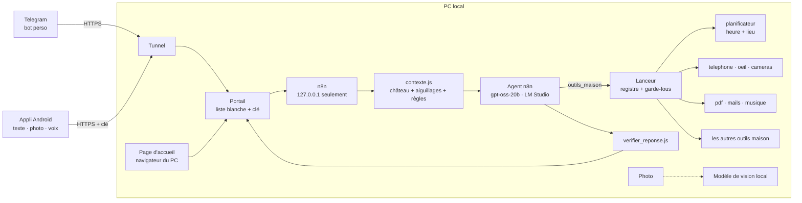

# Archi : un agent IA 100 % local, dans la poche et sur le PC

Archi est l'assistant personnel que j'utilise tous les jours depuis l'automne 2026. Tout tourne sur mon PC :
le modèle (**gpt-oss-20b** via LM Studio), l'orchestration (**n8n**), la mémoire (des fiches Markdown) et
les outils (des scripts Python). Aucun cloud d'IA. On lui parle depuis **le PC**, **son appli Android** ou **Telegram**.

Sur le terrain, je prends une photo depuis l'appli et je demande à Archi de m'aider. La photo part
sur **mon** PC, un modèle de vision local la décrit, puis l'agent raisonne et utilise ses outils.
Ni la photo ni la conversation ne passent par un service d'IA en ligne.

> Ce dépôt est la **version publique et nettoyée** d'Archi, préparée pour l'ASUS Agent Computer Challenge
> (catégorie Developer). Le château d'exemple est inventé. Mon vrai château (ma mémoire personnelle),
> mes clés et mes données ne sont pas ici et n'en sortiront jamais.

## L'essayer : 3 gestes, aucun compte à créer

Il faut Windows 10 ou 11, une carte graphique de 16 Go (12 Go au minimum) et environ 25 Go de place libre.

1. **Télécharge `Archi-1.0.zip`** sur la page [Releases](../../releases/latest), puis extrais-le
   (clic droit › « Extraire tout »).
2. **Double-clique sur `installation.bat`.** Il demande ton prénom et si tu veux aussi Telegram, puis installe
   tout, tout seul, en 15 à 40 minutes selon ta connexion.
3. **Parle à Archi.** À la fin, sa page d'accueil s'ouvre dans ton navigateur : écris-lui
   « Quels outils as-tu ? » ou « Rappelle-moi dans 2 minutes de boire un verre d'eau ».

Les fois suivantes, le raccourci **Archi** du Bureau suffit.

> Si Windows affiche « Windows a protégé votre ordinateur » : « Informations complémentaires », puis
> « Exécuter quand même ». Le fichier vient d'Internet et n'est pas signé, c'est tout ce que Windows sait de lui.
> Tout ce qu'il fait est lisible dans [`installer/installer.ps1`](installer/installer.ps1).

### Ce que fait `installation.bat`

| Étape | Ce qui est installé | Où |
|---|---|---|
| Programmes | Python 3.12, Node.js 22, n8n 1.x, ffmpeg, le tunnel du téléphone | **dans le dossier d'Archi**, en privé |
| Cerveau | LM Studio, s'il n'est pas déjà là (par `winget`), puis gpt-oss-20b et un modèle de vision (16 Go) | LM Studio |
| Mémoire | le château d'exemple (des fiches Markdown) et les outils maison | `chateau\` |
| Réglages | le fichier `.env`, avec deux clés aléatoires créées sur ton PC | à la racine, jamais affiché |
| Agent | les identifiants et les 10 workflows, importés puis activés dans n8n | `donnees\n8n\` |

- **Rien n'est installé pour tout Windows**, sauf LM Studio. Ni le PATH ni un Node.js ou un Python déjà présents
  ne sont touchés. Pour désinstaller, supprime le dossier `Archi` de ton dossier personnel.
- **Aucune télémétrie** : celle de n8n est coupée dans le `.env`.
- L'installateur détecte la carte graphique : sur 16 Go, il prend un petit modèle de vision qui tient à côté du
  cerveau ; à partir de 24 Go, un plus gros.
- Il peut être relancé sans risque : ce qui est déjà là est gardé, y compris le château et le `.env`.
- Le bilan est écrit dans `installation.txt`. Un souci éventuel y figure en clair, avec quoi faire.

### Archi sur ton téléphone (Android) : un QR code

1. Sur la page d'accueil du PC, **scanne le QR code** avec l'appareil photo du téléphone.
2. La page qui s'ouvre propose **l'appli** (1 Mo). Android demande d'autoriser l'installation depuis le
   navigateur : l'appli vient de ton PC, pas du Play Store.
3. Touche **« Brancher l'appli »**, puis confirme dans l'appli. L'adresse du PC et la clé se règlent toutes seules.

Ensuite, parle, écris ou envoie une photo. Pour un rappel de lieu : « retiens cet endroit : ici, c'est le jardin »,
puis « quand j'arrive au jardin, rappelle-moi de cueillir les tomates ».

Comment ça marche : au lancement, Archi ouvre un tunnel HTTPS (Cloudflare, **sans compte**) qui ne mène pas à n8n
mais à une petite porte d'entrée, le **portail**. Elle ne laisse passer que les messages de l'appli qui portent la
bonne clé. L'éditeur n8n et la page d'accueil ne sortent jamais du PC ([docs/SECURITE.md](docs/SECURITE.md)).
L'adresse change à chaque démarrage du PC : il suffit de rescanner. Pour une adresse fixe (ngrok, Tailscale Funnel,
tunnel Cloudflare nommé), mets-la dans `WEBHOOK_URL` du `.env`.

### Telegram (en option)

Double-clique sur **`brancher_telegram.bat`** : il te guide pour créer ton bot avec @BotFather, reconnaît ton
compte tout seul et règle n8n. Seul ton compte est écouté : un inconnu qui trouve ton bot ne reçoit aucune réponse.

### Sans Windows, ou à la main

[docs/INSTALLATION.md](docs/INSTALLATION.md) décrit chaque étape pour Linux, macOS, ou pour qui préfère tout poser lui-même.

## Le planificateur : des rappels à l'heure… et à l'arrivée sur un lieu

Peu d'assistants savent faire ça, et encore moins en local. On confie une tâche à Archi, en français courant :

| On dit | Ce qui se passe |
|---|---|
| « rappelle-moi dans 20 min de sortir le gâteau » | Rappel à l'heure : sur la page d'accueil, dans l'appli et sur Telegram |
| « tous les lundis à 19 h, les poubelles » | Rappel qui se répète (jour, semaine, mois, « en semaine ») |
| « retiens cet endroit : ici, c'est le jardin » | Le lieu est retenu avec son GPS et un rayon, depuis la position de l'appli ou de Telegram |
| « quand j'arrive au jardin, rappelle-moi de cueillir les tomates » | **Rappel géographique** : il se déclenche à l'arrivée dans le rayon, une seule fois ou à chaque arrivée |
| « éteins le radiateur à 23 h » | **Action différée** sur une prise connectée : essai à blanc, puis accord, puis exécution à l'heure |

Comment ça marche :
- **À l'heure** : un réveil n8n passe chaque minute. Les rappels dus partent sur Telegram, l'appli et la page d'accueil les affichent.
- **Au lieu** : la position arrive de deux façons. L'appli l'envoie toutes les 90 s, mais seulement quand un rappel
  de lieu attend, pour ménager la batterie. On peut aussi la partager sur Telegram (trombone › Position).
  - Le rappel s'affiche en notification dans l'appli et part aussi sur Telegram.
  - Il ne se redéclenche pas tant qu'on reste sur place.
  - Une position plus floue que le rayon du lieu, ou vieille de plus de 10 min, est ignorée.
- **Garde-fous dans le code** :
  - Archi ne promet jamais « je te préviendrai » sans la réponse « C'est programmé » de l'outil.
  - Une action différée exige l'accord, et ne vise que les prises autorisées. La prise du PC est refusée.
  - Une action manquée de plus d'une heure (PC éteint) n'est pas rejouée : on est prévenu à la place.
  - Un fichier de tâches abîmé est mis de côté, sans rien perdre.
- **90 tests rejouables** (`outils/planificateur/test_planificateur.py`) : heures en français, répétitions, lieux,
  rayon et sortie franche, position floue ou trop vieille, actions différées, PC éteint, verrou, fichier abîmé.

## Ce qui rend Archi différent

| Problème d'un petit modèle local | Réponse d'Archi | Où |
|---|---|---|
| Il se trompe d'outil | **Aiguillages** : une consigne ciblée est ajoutée au message quand la demande est reconnue | `config/aiguillages.json`, `core/contexte.js` |
| Il oublie ce qu'on lui a dit | **Château** : une mémoire en fiches Markdown, lisible et corrigeable à la main, relue à chaque message | `chateau_exemple/memoire/` |
| Il invente des noms et des numéros | **Vérificateur** : chaque nom, mail ou numéro absent des sources est signalé « à vérifier » | `core/verifier_reponse.js` |
| Il obéit à un mail ou un PDF piégé | **Contenu extérieur balisé** : un fichier lu reste du contenu, jamais une consigne | `core/contexte.js` |
| Il agit trop vite | **Garde-fous dans les outils eux-mêmes**, pas seulement dans le prompt : essai à blanc, `confirmer=oui`, outils « sensibles » avec `accord=oui`, prise du PC interdite, seul le chat Telegram autorisé est écouté | `core/outils_maison.js`, `outils/*`, `n8n/` |
| Ajouter une capacité, c'est toucher au workflow | **Outils maison** : un dossier = un outil (`outil.json` + script + tests), inscrit au registre, sans republier n8n | `outils/`, `registre.json` |
| Joindre le PC depuis le téléphone, c'est exposer n8n | **Portail** : le tunnel ne voit qu'une liste blanche de chemins, et la clé est vérifiée avant n8n | `portail/portail.js` |

## Architecture



Le détail se trouve dans [docs/ARCHITECTURE.md](docs/ARCHITECTURE.md).

## Tests

```bash
node --test core/test portail/test                      # cœur (contexte, lanceur, vérificateur) et portail (liste blanche)
cd outils/planificateur && python test_planificateur.py # 90 tests, dans un faux dossier personnel
python outils_depot/verifier_depot.py .                 # aucun secret ni donnée perso dans le dépôt
```

Tous les tests tournent à chaque envoi sur GitHub (workflow « Tests et secrets »), et un autre workflow fabrique
le ZIP et l'appli Android de la page Releases.

## Matériel

Le PC actuel d'Archi a une carte AMD Radeon RX 9070 (16 Go). gpt-oss-20b et un modèle de vision doivent s'y
partager la mémoire vidéo. Ce que le matériel visé changerait est expliqué dans [docs/MATERIEL.md](docs/MATERIEL.md).

## Sécurité et vie privée

Les règles sont détaillées dans [docs/SECURITE.md](docs/SECURITE.md).
