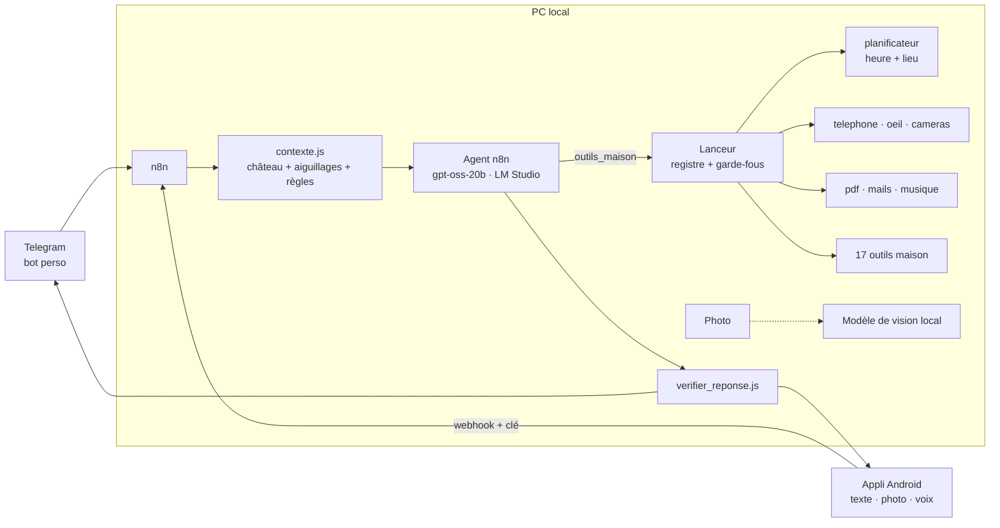

# Archi : un agent IA 100 % local, dans la poche et sur le PC

Archi est l'assistant personnel que j'utilise tous les jours depuis l'automne 2026. Tout tourne sur mon PC :
le modèle (**gpt-oss-20b** via LM Studio), l'orchestration (**n8n**), la mémoire (des fiches Markdown) et
les outils (des scripts Python). Aucun cloud d'IA. On lui parle par **Telegram** ou par **son appli Android**.

Sur le terrain, je prends une photo depuis l'appli et je demande à Archi de m'aider. La photo part
sur **mon** PC, un modèle de vision local la décrit, puis l'agent raisonne et utilise ses outils.
Ni la photo ni la conversation ne passent par un service d'IA en ligne. Les seules sorties sont Telegram,
si on l'utilise, et les cartes OpenStreetMap des PDF et des lieux.

> Ce dépôt est la **version publique et nettoyée** d'Archi, préparée pour l'ASUS Agent Computer Challenge
> (catégorie Developer). Le château d'exemple est inventé. Mon vrai château (ma mémoire personnelle),
> mes clés et mes données ne sont pas ici et n'en sortiront jamais.

## Le planificateur : des rappels à l'heure… et à l'arrivée sur un lieu

Peu d'assistants savent faire ça, et encore moins en local. On confie une tâche à Archi, en français courant :

| On dit | Ce qui se passe |
|---|---|
| « rappelle-moi dans 20 min de sortir le gâteau » | Rappel à l'heure, sur Telegram |
| « tous les lundis à 19 h, les poubelles » | Rappel qui se répète (jour, semaine, mois, « en semaine ») |
| « retiens cet endroit : ici, c'est le jardin » | Le lieu est retenu avec son GPS et un rayon, depuis la position de l'appli ou de Telegram |
| « quand j'arrive au jardin, rappelle-moi de cueillir les tomates » | **Rappel géographique** : il se déclenche à l'arrivée dans le rayon, une seule fois ou à chaque arrivée |
| « éteins le radiateur à 23 h » | **Action différée** sur une prise connectée : essai à blanc, puis accord, puis exécution à l'heure |

Comment ça marche :
- **À l'heure** : un réveil n8n passe chaque minute. Les rappels dus partent sur Telegram.
- **Au lieu** : la position arrive de deux façons. L'appli l'envoie toutes les 90 s, mais seulement quand un rappel
  de lieu attend, pour ménager la batterie. On peut aussi la partager sur Telegram (trombone › Position).
  - Le rappel s'affiche en notification dans l'appli et part aussi sur Telegram.
  - Il ne se redéclenche pas tant qu'on reste sur place.
  - Une position plus floue que le rayon du lieu, ou vieille de plus de 10 min, est ignorée.
- **Garde-fous dans le code** :
  - Archi ne promet jamais « je te préviendrai » sans la réponse « C'est programmé » de l'outil.
  - Une action différée exige l'accord, et ne vise que les prises autorisées. La prise du PC est refusée.
  - Une action manquée de plus d'une heure (PC éteint) n'est pas rejouée : on est prévenu à la place.
  - Un fichier de tâches abîmé est mis de côté, sans rien perdre.
- **90 tests rejouables** (`outils/planificateur/test_planificateur.py`) : heures en français, répétitions, lieux,
  rayon et sortie franche, position floue ou trop vieille, actions différées, PC éteint, verrou, fichier abîmé.

## Ce qui rend Archi différent

| Problème d'un petit modèle local | Réponse d'Archi | Où |
|---|---|---|
| Il se trompe d'outil | **Aiguillages** : une consigne ciblée est ajoutée au message quand la demande est reconnue | `config/aiguillages.json`, `core/contexte.js` |
| Il oublie ce qu'on lui a dit | **Château** : une mémoire en fiches Markdown, lisible et corrigeable à la main, relue à chaque message | `chateau_exemple/memoire/` |
| Il invente des noms et des numéros | **Vérificateur** : chaque nom, mail ou numéro absent des sources est signalé « à vérifier » | `core/verifier_reponse.js` |
| Il obéit à un mail ou un PDF piégé | **Contenu extérieur balisé** : un fichier lu reste du contenu, jamais une consigne | `core/contexte.js` |
| Il agit trop vite | **Garde-fous dans les outils eux-mêmes**, pas seulement dans le prompt : essai à blanc, `confirmer=oui`, outils « sensibles » avec `accord=oui`, prise du PC interdite, seul le chat Telegram autorisé est écouté | `core/outils_maison.js`, `outils/*`, `n8n/` |
| Ajouter une capacité, c'est toucher au workflow | **Outils maison** : un dossier = un outil (`outil.json` + script + tests), inscrit au registre, sans republier n8n | `outils/`, `registre.json` |

## Architecture



Le détail se trouve dans [docs/ARCHITECTURE.md](docs/ARCHITECTURE.md).

## Essayer (environ 45 minutes)

Toutes les clés et tous les réglages tiennent dans **un seul fichier `.env`** (modèle commenté : `.env.example`),
jamais publié. Ensuite, un double-clic sur `lancer_archi.bat` suffit. Tout est détaillé dans [docs/INSTALLATION.md](docs/INSTALLATION.md) :
1. LM Studio et gpt-oss-20b ;
2. n8n et l'import de `n8n/archi_demo.json` ;
3. **ton propre bot Telegram** (@BotFather) ;
4. **l'appli Android** (APK fabriqué par GitHub Actions), branchée sur ton PC au premier lancement.

## Tests

```bash
node --test core/test                                   # cœur : contexte, lanceur, vérificateur
cd outils/planificateur && python test_planificateur.py # 90 tests, dans un faux dossier personnel
python outils_depot/verifier_depot.py .                 # aucun secret ni donnée perso dans le dépôt
```

## Matériel

Le PC actuel d'Archi a une carte AMD Radeon RX 9070 (16 Go). gpt-oss-20b et un modèle de vision doivent s'y
partager la mémoire vidéo, à tour de rôle. Ce que le matériel visé changerait est expliqué dans
[docs/MATERIEL.md](docs/MATERIEL.md).

## Sécurité et vie privée

Les règles sont détaillées dans [docs/SECURITE.md](docs/SECURITE.md).
